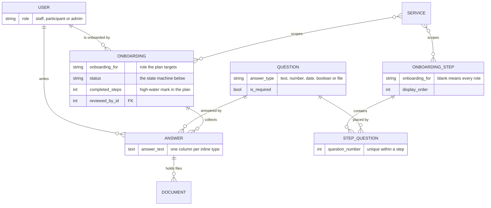
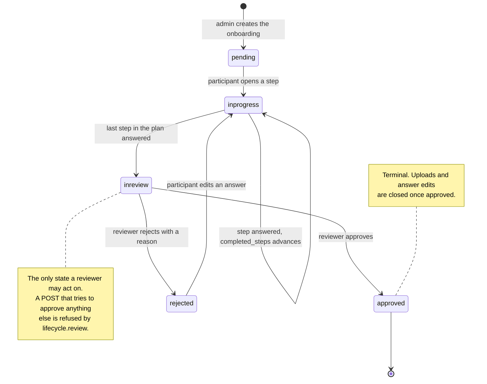
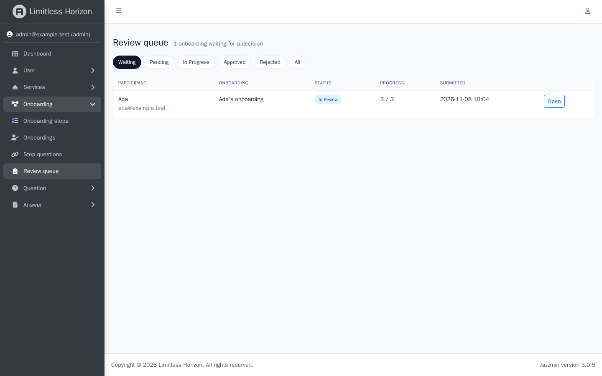
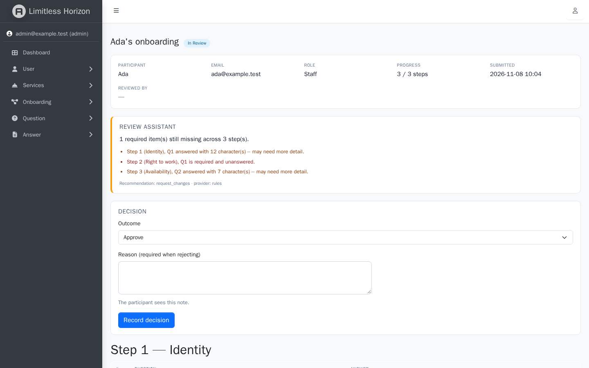
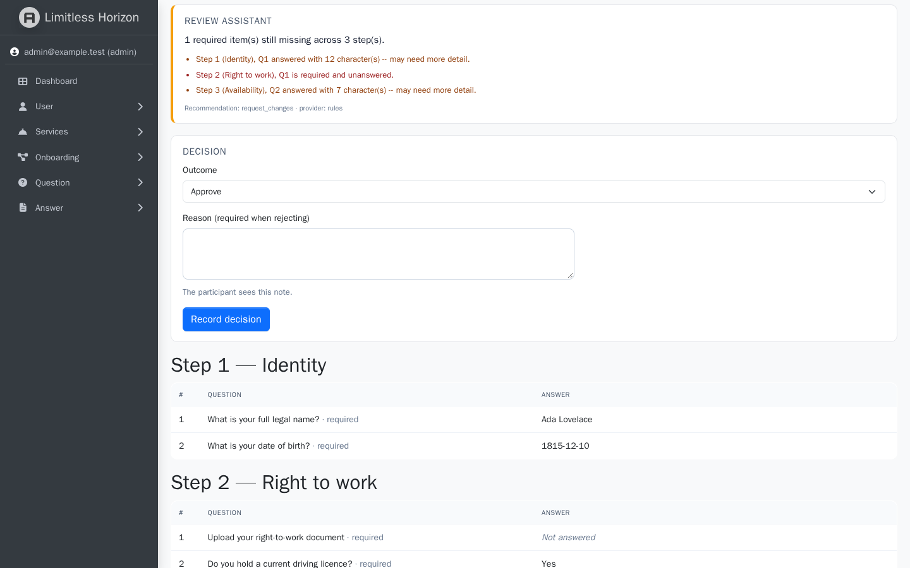
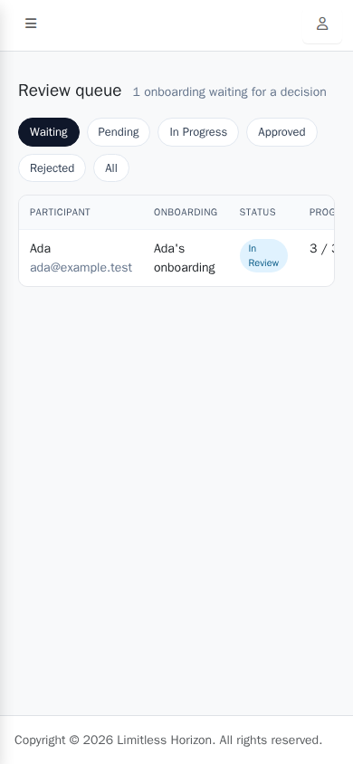
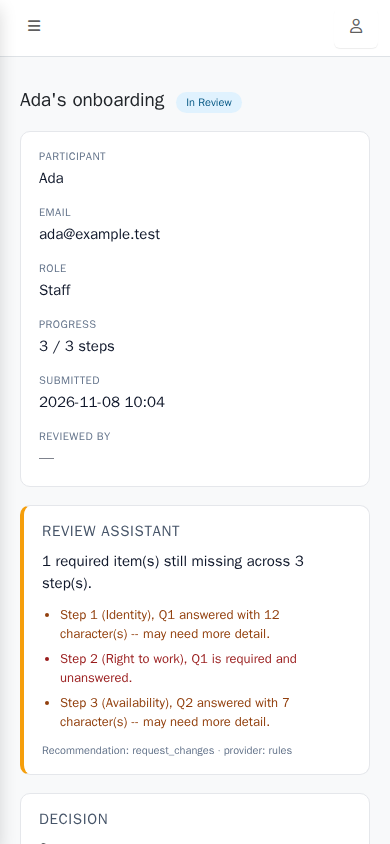

# Limitless Horizon — onboarding questionnaire service

A Django REST service for questionnaires that differ per person. A care
provider onboards staff and participants: a support worker must upload a
right-to-work document, a participant answers a support-needs question, and
somebody on the residential-care contract gets two extra availability
questions nobody else sees.

Steps are **templates**, not rows copied per person. A step targets a role, a
set of services, or nobody in particular, and each participant's step list —
including the "step 3 of 7" numbering they see — is computed from those targets
when they ask for it. On the seeded data a staff member on the
residential-care contract gets three steps and a participant gets two, from
the same rows. That one decision shapes most of this codebase.

## What the database holds



There is no `onboarding_step_instance` table and `Onboarding` stores no step
count. `onboarding/step_plan.py` derives both: `build_step_plan(onboarding)`
returns a `StepPlan` answering `len(plan)`, `plan.number_for(step_id)` and
`plan.step_at(n)`.

## How an onboarding moves



That table is `TRANSITIONS` in `onboarding/lifecycle.py`, the only thing that
writes `Onboarding.status` — views, admin screens and API all go through the
same four functions, so "can this happen" has one answer rather than one per
entry point.

## Reviewing

The reviewer's screens are the only UI here — Django admin pages under
**Onboarding → Review queue**, which shows what is waiting by default.





Every answer renders through its type's handler, so dates, numbers and yes/no
answers are as visible as prose, and a file answer lists its documents with
their approval state:



On a phone the tables scroll sideways rather than squeezing the answers:

 

### The review assistant

`review_assistant/` reads a submitted questionnaire before the reviewer does.
It is a provider port with two implementations. `rules`, the default, is
deterministic: a required-but-unanswered question becomes a blocker, while
short free text and unapproved uploads become warnings. `anthropic`, set by
`REVIEW_ASSISTANT_PROVIDER=anthropic` with `ANTHROPIC_API_KEY` set, sends the
brief to the Messages API over `urllib` and parses a JSON verdict.

**The repository runs the same way with no API key.** With no key the registry
returns the rule engine, and if the HTTP call fails for any reason the provider
falls back to it and labels the result `rules (fallback from anthropic)`.

The model never gets the last word on completeness. The prompt contains text
the participant wrote, so a reply recommending approval while a required
question is unanswered is overridden: the rule engine's blockers are put back
and the recommendation becomes `request_changes`.

## Running it

Requires Python 3.12 (pinned in `backend/.python-version`),
[uv](https://github.com/astral-sh/uv) and `make`. Everything happens in
`backend/`.

```bash
cd backend
cp .env.example .env         # every value already has a working default
make install                 # creates .venv from uv.lock
make migrate
make seed                    # 2 services, 4 steps, 7 questions, 4 participants
make run                     # http://127.0.0.1:8000/
```

`make seed` prints the admin credentials it created, and the seeded data covers
every lifecycle state, so the review queue has something in it immediately.
The database is SQLite next to `manage.py` — no service to start. For MySQL
instead, uncomment the `DB_*` block in `.env` and run `docker compose up db`.

`make check` runs ruff lint, the ruff format check, Django's system checks and
a missing-migration check; `make test` runs the suite. `make help` lists the rest of the targets out of the Makefile itself, so this
README does not keep a copy of them in step.

Useful URLs once running: `/admin/`, `/swagger/`, `/redoc/`, `/healthz/`.

## The API

JWT bearer tokens. `POST /api/user/login/` returns an access and a refresh
token; send `Authorization: Bearer <access>`.

| Method | Path | Who | Purpose |
|---|---|---|---|
| POST | `/api/user/login/` | anyone | Exchange email and password for a token pair |
| GET | `/api/user/me/` | any user | The authenticated user |
| POST | `/api/user/logout/` | any user | Blacklist a refresh token |
| POST | `/api/user/token-refresh/` | any user | Rotate the access token |
| GET | `/api/onboarding/user/` | participant | Own onboardings, paginated |
| GET | `/api/onboarding/{id}/steps/` | owner or staff | The whole plan with saved answers |
| GET | `/api/onboarding/{id}/step/{n}/` | owner or staff | One step, if it is unlocked |
| POST | `/api/onboarding/user/answer/` | owner | Save one step's answers |
| GET | `/api/onboarding/{id}/status/` | owner or staff | Progress and any review reason |
| PATCH | `/api/onboarding/{id}/review/` | staff | Approve or reject |
| GET | `/api/onboarding/{id}/review-summary/` | staff | The assistant's verdict |
| POST | `/api/answer/upload/` | owner | Attach a file to a file question |
| GET | `/api/answer/documents/` | any user | Own uploads, paginated and filterable |
| GET | `/api/answer/documents/{id}/file/` | owner or staff | Download one upload |
| GET | `/api/question/` | staff | The question bank |
| GET | `/healthz/` | anyone | Liveness plus a database round-trip |

### A session against the seed data

Captured from `make seed && make run` on a fresh checkout. Blaise is a staff
member on the residential-care contract who has finished step 1 of 3; tokens
are shortened. Log in and list your onboardings:

```http
POST /api/user/login/
{"email": "blaise@example.test", "password": "demo-password-1"}

200 {"access": "eyJhbGciOi...", "refresh": "eyJhbGciOi...", "role": "staff", "user_id": 3}

GET /api/onboarding/user/

200 {"count": 1, "next": null, "previous": null, "results": [
      {"id": 2, "onboarding_title": "Blaise's onboarding", "onboarding_for": "staff",
       "status": "inprogress", "total_steps": 3, "completed_steps": 1,
       "is_editable": true, "review_reason": null, "reviewed_at": null, ...}]}
```

Step 2 is open, step 3 is not:

```http
GET /api/onboarding/2/step/3/

400 {"detail": "Step 3 is locked. Complete step 2 first."}
```

Step 2 asks for a file, which goes through the upload endpoint rather than the
JSON submit. Only PDF and images are accepted, and the file comes back through
an authenticated URL, not a `/media/` path:

```http
POST /api/answer/upload/   (multipart: onboarding_id=2, question_id=3, file=blaise-pascal-visa.pdf)

201 {"id": 1, "answer": 11, "question_id": 3, "onboarding_id": 2,
     "name": "blaise-pascal-visa.pdf", "file_url": "/api/answer/documents/1/file/",
     "is_approved": false, "rejection_reason": null, "uploaded_at": "2026-11-08T09:53:17Z"}

POST /api/answer/upload/   (multipart: ..., file=notes.html)

400 {"file": ["Unsupported file type. Allowed: jpeg, jpg, pdf, png."]}

GET /api/answer/documents/1/file/               as Blaise
200 application/pdf, Content-Disposition: attachment; filename="blaise-pascal-visa.pdf"

GET /api/answer/documents/1/file/               as Dora, another participant
404 {"detail": "No Document matches the given query."}
```

A yes/no question answered in the text column is refused; `false` is a real
answer. Submitting the last step sends the onboarding for review:

```http
POST /api/onboarding/user/answer/
{"onboarding_id": 2, "step_id": 2, "responses": [{"question_id": 4, "answer": {"answer_text": "yes"}}]}

400 {"detail": "Question 4 expects 'answer_boolean' for answer type 'boolean'."}

POST /api/onboarding/user/answer/
{"onboarding_id": 2, "step_id": 2, "responses": [{"question_id": 4, "answer": {"answer_boolean": false}}]}

201 {"onboarding_id": 2, "step_number": 2, "total_steps": 3, "completed_steps": 2,
     "status": "inprogress", "submitted_for_review": false}

POST /api/onboarding/user/answer/
{"onboarding_id": 2, "step_id": 3, "responses": [
   {"question_id": 5, "answer": {"answer_number": "22.5"}},
   {"question_id": 6, "answer": {"answer_text": "Weekday late shifts, no nights"}}]}

201 {"onboarding_id": 2, "step_number": 3, "total_steps": 3, "completed_steps": 3,
     "status": "inreview", "submitted_for_review": true}
```

The reviewer (the seeded admin) reads the assistant's summary and rejects,
which needs a reason; the participant sees it on the status endpoint:

```http
GET /api/onboarding/2/review-summary/

200 {"recommendation": "approve",
     "headline": "Every required question is answered. 2 item(s) are worth a second look.",
     "provider": "rules",
     "findings": [
       {"severity": "warning", "message": "Step 1 (Identity), Q1 answered with 13 character(s) -- may need more detail."},
       {"severity": "warning", "message": "Step 2 (Right to work), Q1 has 1 uploaded file(s), none approved yet."}]}

PATCH /api/onboarding/2/review/   {"status": "rejected"}
400 {"review_reason": ["Write a reason for the rejection"]}

PATCH /api/onboarding/2/review/
{"status": "rejected", "review_reason": "The visa scan is unreadable; please upload a clearer copy."}
200 {"id": 2, "status": "rejected", "completed_steps": 3,
     "review_reason": "The visa scan is unreadable; please upload a clearer copy.", ...}

GET /api/onboarding/2/status/                   as Dora
404 {"detail": "No Onboarding matches the given query."}
```

Every object lookup is scoped to the caller: a participant asking for somebody
else's onboarding gets a 404, not a 403 and not the record — including on the
status endpoint, the one that carries the reviewer's rejection note. Staff see
everything. `tests/test_onboarding_api.py::OwnershipTests` holds that down.

## Answer types

A question's `answer_type` picks a handler from the registry in
`answer/answer_types.py`. The handler owns everything type-specific: which
column stores the value, whether the value may arrive in the JSON body, what
counts as answered, and how to render it.

The boolean handler is why this is a registry and not a dict of field names:
`False` is a real answer to a yes/no question, so it overrides `is_answered`.
The file handler sets `accepts_inline_value = False`, which is what turns a
submit payload for a file question into a validation error pointing at
`POST /api/answer/upload/`. Adding a type is a `TextChoices` member and one
class.

## Uploads

File answers are identity and right-to-work documents, so they are handled
more strictly than the rest of the data:

- They are stored under a random name (`documents/<uuid>.pdf`). The name the
  participant gave the file, which often contains their own name, is kept in
  `Document.original_name` and used only as the download's file name.
- Nothing serves `MEDIA_ROOT` over HTTP. `GET /api/answer/documents/{id}/file/`
  streams a file to the person who uploaded it or to staff, with
  `Cache-Control: private, no-store`; anyone else gets a 404. The reviewer's
  admin links go through the same view, using the admin session.
- Only the extensions in `ALLOWED_UPLOAD_EXTENSIONS` are accepted (PDF, JPEG
  and PNG by default), up to `MAX_UPLOAD_SIZE_MB`.
- The test runner points `MEDIA_ROOT` at a temporary folder, so running the
  suite never writes next to real uploads.

## Configuration

Everything is read from the environment in `backend/settings.py`, and
`.env.example` lists every variable with a comment. The ones worth knowing:

| Variable | Default | Notes |
|---|---|---|
| `SECRET_KEY` | throwaway dev key | **Required** when `ENVIRONMENT` is not `development` — startup fails without it |
| `DEBUG` | true in development | When false, adds HSTS, secure cookies and SSL redirect |
| `DB_ENGINE` | `django.db.backends.sqlite3` | Point at the MySQL backend to use the compose service |
| `CORS_ALLOWED_ORIGINS` | `FRONTEND_URL` | An explicit list. Credentialed requests and "allow any origin" cannot both be true |
| `ALLOWED_UPLOAD_EXTENSIONS` | `pdf,jpg,jpeg,png` | Anything else is refused at upload |
| `REVIEW_ASSISTANT_PROVIDER` | `rules` | `anthropic` also needs `ANTHROPIC_API_KEY`; answers are then sent to that API |

## Tests

```console
$ make test
Ran 134 tests in 40.773s

OK
```

`backend/tests/` runs on Django's own runner against SQLite — no services, no
network, no API key. It covers the transition table and step locking;
ownership scoping on every endpoint, and upload membership in both directions
(a question from another service's step is refused, an "all roles" step is
accepted); the assistant's verdicts, provider selection and HTTP fallback
through an injected transport; the reviewer's screens rendering every answer
type and refusing a crafted POST that would skip the state machine; and query
counts — the step planner, review brief, onboarding list, review queue and
admin changelist each assert the same count for one row as for many. It also
pins down the document download rules, the seed command's per-plan answers,
and that a stale onboarding instance cannot approve or save past a decision
made in the meantime.

## Containers

`backend/Dockerfile` is two stages: the first resolves `uv.lock` into
`/opt/venv` with the MySQL headers available, the second keeps only the shared
library and runs as a non-root `app` user. Static files are collected at build
time and served by WhiteNoise, so nothing needs to sit in front of gunicorn.
`docker-entrypoint.sh` migrates before starting it, and `HEALTHCHECK` polls
`/healthz/`.

`docker compose config` parses cleanly. The image build and the MySQL stack
have **not** been run; the SQLite path above is the verified one.

## Known limits

- **No frontend.** `FRONTEND_URL` appears only in the invite email and the
  CORS allowlist.
- **Changing a question's `answer_type` after answers exist** leaves values
  stranded in the old column. There is no migration path for that.
- **Storage is local.** `FILE_STORAGE_BACKEND` takes any Django storage
  backend class path, but nothing here configures a remote one. The download
  view reads through the storage API, so a remote backend would still be
  served through it rather than by public URL.
- **The "thin answer" warning is length-based.** A full name of under
  `REVIEW_ASSISTANT_THIN_ANSWER_CHARS` characters is flagged like a terse
  description would be.
- **Uploading after a rejection reopens the onboarding but does not resubmit
  it.** The participant resubmits by saving any step again.

## License

MIT, see [LICENSE](LICENSE).
