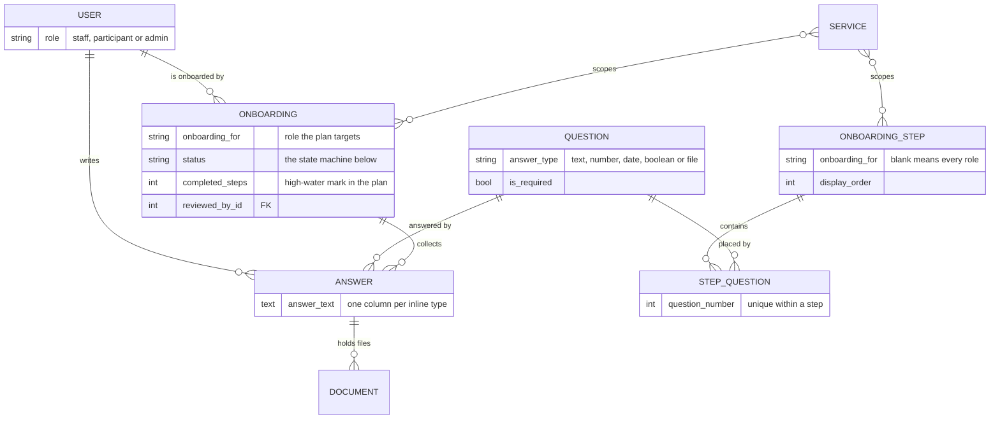
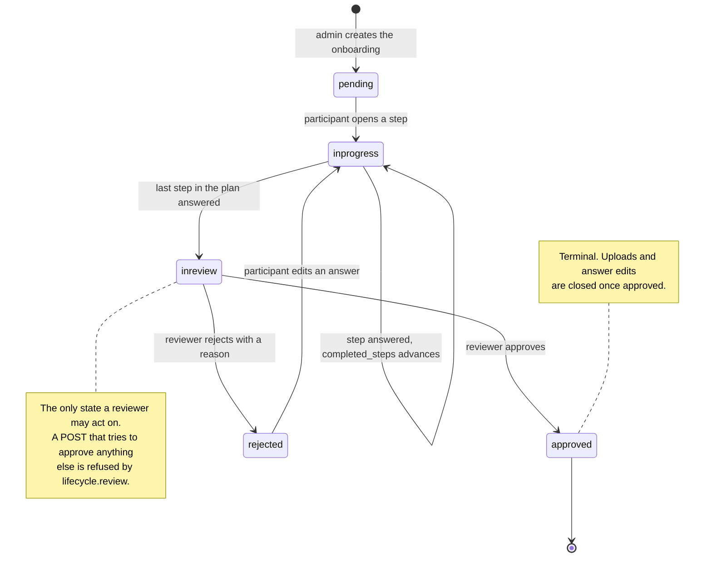
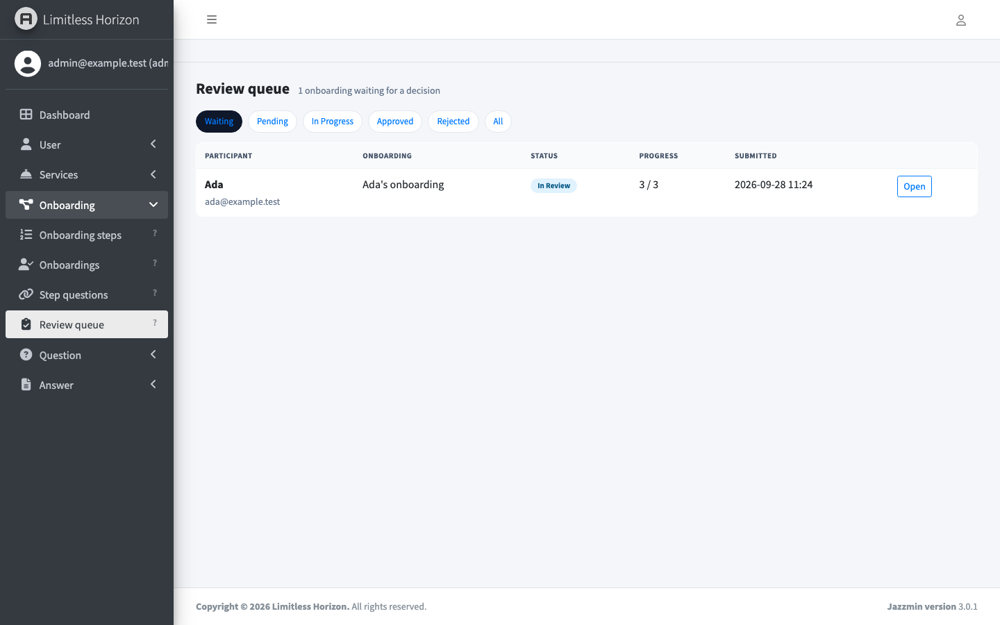
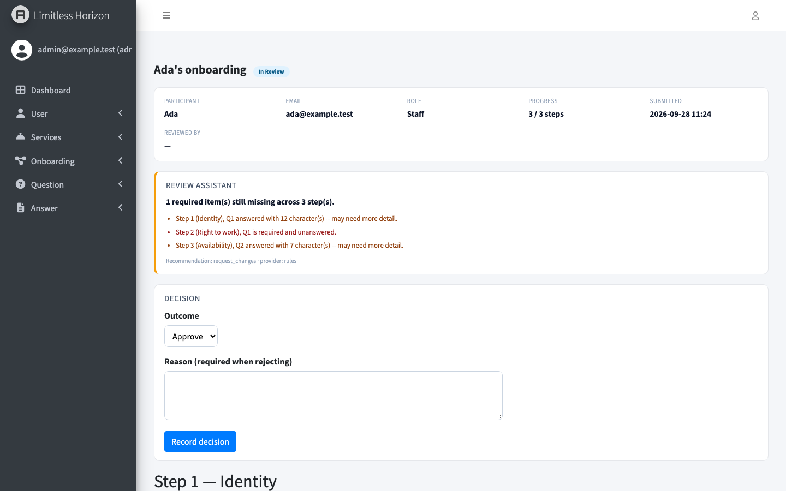
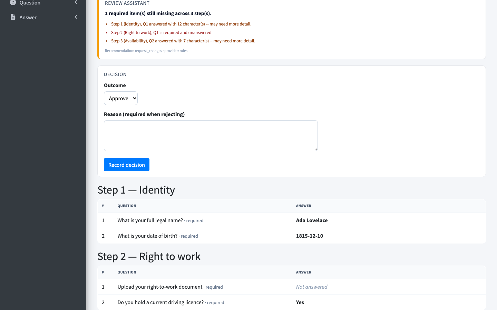

# Limitless Horizon — onboarding questionnaire service

A Django REST service for questionnaires that differ per person. A care
provider onboards staff and participants: a support worker must upload a
right-to-work document, a participant answers a support-needs question, and
somebody on the residential-care contract gets two extra availability
questions nobody else sees.

Steps are **templates**, not rows copied per person. A step targets a role, a
set of services, or nobody in particular, and each participant's step list —
including the "step 3 of 7" numbering they see — is computed from those targets
when they ask for it. On the seeded data a staff member on the
residential-care contract gets three steps and a participant gets two, from
the same rows. That one decision shapes most of this codebase.

## What the database holds



There is no `onboarding_step_instance` table and `Onboarding` stores no step
count. `onboarding/step_plan.py` derives both: `build_step_plan(onboarding)`
returns a `StepPlan` answering `len(plan)`, `plan.number_for(step_id)` and
`plan.step_at(n)`.

## How an onboarding moves



That table is `TRANSITIONS` in `onboarding/lifecycle.py`, the only thing that
writes `Onboarding.status` — views, admin screens and API all go through the
same four functions, so "can this happen" has one answer rather than one per
entry point.

## Reviewing

The reviewer's screens are the only UI here — Django admin pages under
**Onboarding → Review queue**, which shows what is waiting by default.





Every answer renders through its type's handler, so dates, numbers and yes/no
answers are as visible as prose, and a file answer lists its documents with
their approval state:



### The review assistant

`review_assistant/` reads a submitted questionnaire before the reviewer does.
It is a provider port with two implementations. `rules`, the default, is
deterministic: a required-but-unanswered question becomes a blocker, while
short free text and unapproved uploads become warnings. `anthropic`, set by
`REVIEW_ASSISTANT_PROVIDER=anthropic` with `ANTHROPIC_API_KEY` set, sends the
brief to the Messages API over `urllib` and parses a JSON verdict.

**The repository runs the same way with no API key.** With no key the registry
returns the rule engine, and if the HTTP call fails for any reason the provider
falls back to it and labels the result `rules (fallback from anthropic)`.

## Running it

Requires Python 3.12 and [uv](https://github.com/astral-sh/uv). Everything
happens in `backend/`.

```bash
cd backend
cp .env.example .env         # every value already has a working default
make install                 # creates .venv from uv.lock
make migrate
make seed                    # 2 services, 4 steps, 7 questions, 4 participants
make run                     # http://127.0.0.1:8000/
```

`make seed` prints the admin credentials it created, and the seeded data covers
every lifecycle state, so the review queue has something in it immediately.
The database is SQLite next to `manage.py` — no service to start. For MySQL
instead, uncomment the `DB_*` block in `.env` and run `docker compose up db`.

`make check` is the one to run before pushing — ruff lint, ruff format check,
Django's system checks and a missing-migration check, which is what CI runs.
`make help` lists the rest of the targets out of the Makefile itself, so this
README does not keep a copy of them in step.

Useful URLs once running: `/admin/`, `/swagger/`, `/redoc/`, `/healthz/`.

## The API

JWT bearer tokens. `POST /api/user/login/` returns an access and a refresh
token; send `Authorization: Bearer <access>`.

| Method | Path | Who | Purpose |
|---|---|---|---|
| POST | `/api/user/login/` | anyone | Exchange email and password for a token pair |
| GET | `/api/user/me/` | any user | The authenticated user |
| POST | `/api/user/logout/` | any user | Blacklist a refresh token |
| POST | `/api/user/token-refresh/` | any user | Rotate the access token |
| GET | `/api/onboarding/user/` | participant | Own onboardings, paginated |
| GET | `/api/onboarding/{id}/steps/` | owner or staff | The whole plan with saved answers |
| GET | `/api/onboarding/{id}/step/{n}/` | owner or staff | One step, if it is unlocked |
| POST | `/api/onboarding/user/answer/` | owner | Save one step's answers |
| GET | `/api/onboarding/{id}/status/` | owner or staff | Progress and any review reason |
| PATCH | `/api/onboarding/{id}/review/` | staff | Approve or reject |
| GET | `/api/onboarding/{id}/review-summary/` | staff | The assistant's verdict |
| POST | `/api/answer/upload/` | owner | Attach a file to a file question |
| GET | `/api/answer/documents/` | any user | Own uploads, paginated and filterable |
| GET | `/api/question/` | staff | The question bank |
| GET | `/healthz/` | anyone | Liveness plus a database round-trip |

Answering a step:

```bash
curl -X POST localhost:8000/api/onboarding/user/answer/ \
  -H "Authorization: Bearer $TOKEN" -H 'Content-Type: application/json' \
  -d '{"onboarding_id": 1, "step_id": 1, "responses": [
        {"question_id": 1, "answer": {"answer_text": "Ada Lovelace"}},
        {"question_id": 2, "answer": {"answer_date": "1815-12-10"}}]}'
```

```json
{"onboarding_id": 1, "step_number": 1, "total_steps": 3,
 "completed_steps": 1, "status": "inprogress", "submitted_for_review": false}
```

Every object lookup is scoped to the caller: a participant asking for somebody
else's onboarding gets a 404, not a 403 and not the record — including on the
status endpoint, the one that carries the reviewer's rejection note. Staff see
everything. `tests/test_onboarding_api.py::OwnershipTests` holds that down.

## Answer types

A question's `answer_type` picks a handler from the registry in
`answer/answer_types.py`. The handler owns everything type-specific: which
column stores the value, whether the value may arrive in the JSON body, what
counts as answered, and how to render it.

The boolean handler is why this is a registry and not a dict of field names:
`False` is a real answer to a yes/no question, so it overrides `is_answered`.
The file handler sets `accepts_inline_value = False`, which is what turns a
submit payload for a file question into a validation error pointing at
`POST /api/answer/upload/`. Adding a type is a `TextChoices` member and one
class.

## Configuration

Everything is read from the environment in `backend/settings.py`, and
`.env.example` lists every variable with a comment. The four worth knowing:

| Variable | Default | Notes |
|---|---|---|
| `SECRET_KEY` | throwaway dev key | **Required** when `ENVIRONMENT` is not `development` — startup fails without it |
| `DEBUG` | true in development | When false, adds HSTS, secure cookies and SSL redirect |
| `DB_ENGINE` | `django.db.backends.sqlite3` | Point at the MySQL backend to use the compose service |
| `CORS_ALLOWED_ORIGINS` | `FRONTEND_URL` | An explicit list. Credentialed requests and "allow any origin" cannot both be true |

## Tests

```console
$ make test
Ran 113 tests in 31.092s

OK
```

`backend/tests/` runs on Django's own runner against SQLite — no services, no
network, no API key. It covers the transition table and step locking;
ownership scoping on every endpoint, and upload membership in both directions
(a question from another service's step is refused, an "all roles" step is
accepted); the assistant's verdicts, provider selection and HTTP fallback
through an injected transport; the reviewer's screens rendering every answer
type and refusing a crafted POST that would skip the state machine; and query
counts — the step planner, review brief, onboarding list, review queue and
admin changelist each assert the same count for one row as for many.

CI runs the same suite, plus lint and `docker compose config`, on every push.

## Containers

`backend/Dockerfile` is two stages: the first resolves `uv.lock` into
`/opt/venv` with the MySQL headers available, the second keeps only the shared
library and runs as a non-root `app` user. Static files are collected at build
time and served by WhiteNoise, so nothing needs to sit in front of gunicorn.
`docker-entrypoint.sh` migrates before starting it, and `HEALTHCHECK` polls
`/healthz/`.

`docker compose config` parses cleanly. The image build and boot have **not**
been run here.

## Known limits

- **No frontend.** `FRONTEND_URL` appears only in the invite email and the
  CORS allowlist.
- **Changing a question's `answer_type` after answers exist** leaves values
  stranded in the old column. There is no migration path for that.
- **Storage is local.** `FILE_STORAGE_BACKEND` takes any Django storage
  backend class path, but nothing here configures a remote one.

## Author

[**Muhammad Nadeem**](https://github.com/dev-mnadeem)
